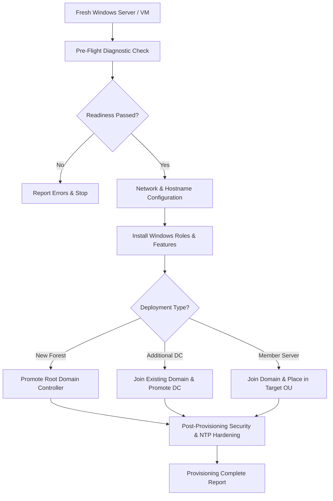

# ⚙️ ADSetupKit

> **Automated Windows Server Provisioning & Active Directory Bootstrapping Module**

[](https://github.com/Karanth1992/ADSetupKit)
[](https://github.com/Karanth1992/ADSetupKit)
[](LICENSE)

**ADSetupKit** is a companion PowerShell module engineered to automate the end-to-end lifecycle of standing up Windows Servers from bare-metal or fresh VM templates — from IP configuration and hostname assignment to role installation, Domain Controller promotion, domain join, and post-provisioning hardening.

---

## 🌟 Key Features

* 🧙‍♂️ **Interactive Setup Wizard (`Start-ADSKSetupWizard`):** Guided terminal interface for fast, error-free server deployment.
* 🌐 **Network & Identity Provisioning:** Automated static IP allocation, DNS configuration, and computer renaming with automatic reboots.
* 🏰 **Active Directory Promotion:** Unattended DC promotion (`Install-ADDSForest` / `Install-ADDSDomainController`) with automated FSMO, SYSVOL, and NTDS directory pathing.
* 📦 **Role & Feature Automation:** One-line installation of AD DS, DNS, DHCP, AD CS (Certificate Services), and IIS roles.
* 🛡️ **Post-Provisioning Hardening:** Disables legacy protocols (SMBv1, NTLMv1), configures enterprise NTP time hierarchy, and applies baseline security configurations.
* 📋 **Pre-Flight Diagnostics (`Test-ADSKProvisioningReadiness`):** Verifies disk space, network connectivity, administrator privileges, and OS version before executing provisioning tasks.

---

## 🏗️ Provisioning Workflow



---

## 🚀 Quick Start & Usage

### 1. Interactive Setup Wizard

```powershell
# Clone the repository
git clone https://github.com/Karanth1992/ADSetupKit.git

# Import the module
Import-Module .\ADSetupKit\ADSetupKit.psd1

# Launch the interactive setup wizard
Start-ADSKSetupWizard
```

### 2. Unattended Automation Example

```powershell
# Pre-flight diagnostic check
Test-ADSKProvisioningReadiness -Role DomainController

# Configure Network Adapter & Hostname
Set-ADSKNetworkConfig -InterfaceName "Ethernet0" `
                      -IPAddress "192.168.1.10" `
                      -PrefixLength 24 `
                      -Gateway "192.168.1.1" `
                      -DNSServers "127.0.0.1" `
                      -NewHostName "DC01-PROD"

# Provision New Active Directory Forest
Install-ADSKForest -DomainName "corp.contoso.com" `
                   -NetBiosName "CORP" `
                   -SafeModePassword (ConvertTo-SecureString "P@ssw0rd123!" -AsPlainText -Force)
```

---

## 📂 Module Structure

```text
ADSetupKit/
├── ADSetupKit.psd1           # Module Manifest
├── ADSetupKit.psm1           # Module Entrypoint
├── Public/                   # Exported Cmdlets & Functions
│   ├── Start-ADSKSetupWizard.ps1
│   ├── Test-ADSKProvisioningReadiness.ps1
│   ├── Set-ADSKNetworkConfig.ps1
│   ├── Install-ADSKForest.ps1
│   ├── Join-ADSKDomain.ps1
│   └── Enable-ADSKHardeningBaseline.ps1
├── Private/                  # Internal Helper Functions
│   ├── Get-DiskSpaceCheck.ps1
│   └── Write-ADSKLog.ps1
├── Config/                   # Deployment Templates
│   └── ServerRolesConfig.json
├── Tests/                    # Pester Unit & Integration Tests
│   └── ADSetupKit.Tests.ps1
└── README.md
```

---

## 🧪 Testing & Validation

This module includes automated Pester tests for syntax verification, PSScriptAnalyzer compliance, and mock execution:

```powershell
# Run Pester test suite
Invoke-Pester -Path .\Tests\
```

---

## 🔗 Related Tooling & References

* 🛡️ **[ADOpsKit](https://github.com/Karanth1992/ADOpsKit):** Active Directory Operational Health, Replication Topology Diagrams, and Security Audit Module (Available on [PowerShell Gallery](https://www.powershellgallery.com/packages/ADOpsKit)).
* 🌐 **[Karanth.ovh](https://www.karanth.ovh):** Field notes, troubleshooting guides, and AD architectural deep-dives.

---

## 📜 License

This project is licensed under the [MIT License](LICENSE).
