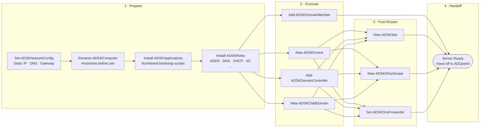

# ⚙️ ADSetupKit

> **Automated Windows Server Provisioning & Active Directory Bootstrapping Module**

[](https://github.com/Karanth1992/ADSetupKit)
[](https://github.com/Karanth1992/ADSetupKit)
[](LICENSE)

**ADSetupKit** is an enterprise PowerShell module engineered to automate the end-to-end lifecycle of standing up Windows Servers from bare-metal or fresh VM templates — from static network configuration and computer renaming to role installation, Domain Controller promotion, domain join, and automated post-restart infrastructure setup.

Detailed workflow diagrams and phase transitions are documented in **[WORKFLOW.md](WORKFLOW.md)**.

Looking for post-promotion operations and health auditing? See **[ADOpsKit](https://github.com/Karanth1992/ADOpsKit)** (published to the PowerShell Gallery) — ADSetupKit provisions the server, and ADOpsKit monitors and audits it.

---

## 🌟 Key Features

* 🧙‍♂️ **Interactive Setup Wizard (`Start-ADSKSetupWizard`):** 7-step guided menu for configuring networking, host renaming, application bootstrapping, role installations, AD promotion scenarios, and post-restart automation.
* 🌐 **Network & Hostname Configuration (`Set-ADSKNetworkConfig`, `Rename-ADSKComputer`):** Configures static IPv4 addressing, gateway, and DNS servers; manages computer renaming prior to domain join.
* 📦 **Role & Application Deployment (`Install-ADSKRoles`, `Install-ADSKApplications`):** Scripted or interactive installation of core Windows roles (`AD-Domain-Services`, `DNS`, `DHCP`, `Web-Server`, `RSAT`, `GPMC`) and ordered execution of software installer scripts.
* 🏰 **Active Directory Promotion Suite:**
  * `New-ADSKForest` — Promotes the first Domain Controller in a new forest.
  * `Add-ADSKDomainController` — Joins an existing domain as a replica DC.
  * `New-ADSKChildDomain` — Provisions a child domain within an existing forest tree.
  * `Add-ADSKDomainMember` — Joins a member server to a target domain without DC promotion.
* 🔁 **Automated Post-Restart Tasks (`New-ADSKSite`, `New-ADSKDhcpScope`, `Set-ADSKDnsForwarder`):** Configures AD sites/subnets, authorizes DHCP scopes, and configures DNS forwarders via an automatic scheduled task registered to execute upon the post-promotion reboot.

---

## 🏗️ Provisioning Workflow



---

## 🚀 Quick Start & Usage

### 1. Interactive Setup Wizard

The interactive wizard orchestrates the full sequence, prompting for configuration details and registering any required post-restart tasks:

```powershell
# Clone the repository
git clone https://github.com/Karanth1992/ADSetupKit.git

# Import the module
Import-Module .\ADSetupKit\ADSetupKit.psd1 -Force

# Launch the interactive setup wizard
Start-ADSKSetupWizard
```

### 2. Scripted Unattended Provisioning

Every step can also be run independently in automated scripts:

```powershell
Import-Module .\ADSetupKit\ADSetupKit.psd1 -Force

# 1. Configure static IP and DNS
Set-ADSKNetworkConfig -AdapterName 'Ethernet0' `
                      -IPAddress '192.168.1.10' `
                      -PrefixLength 24 `
                      -DefaultGateway '192.168.1.1' `
                      -DnsServers @('127.0.0.1', '192.168.1.1')

# 2. Rename computer before promotion
Rename-ADSKComputer -NewName 'DC01-CORP'

# 3. Install required roles
Install-ADSKRoles -Roles @('AD-Domain-Services', 'DNS', 'RSAT-AD-Tools')

# 4. Promote Root Domain Controller (triggers required reboot)
$dsrmPassword = ConvertTo-SecureString 'P@ssw0rd123!Secure' -AsPlainText -Force
New-ADSKForest -DomainName 'corp.contoso.com' `
               -DomainNetBiosName 'CORP' `
               -SafeModePassword $dsrmPassword
```

---

## 📋 Exported Functions

| Function | Stage | Purpose |
|----------|-------|---------|
| `Start-ADSKSetupWizard` | Orchestrator | Interactive 7-step wizard tying all stages together |
| `Set-ADSKNetworkConfig` | Prepare | Configures static IP, subnet prefix, default gateway, and DNS servers |
| `Rename-ADSKComputer` | Prepare | Renames the local computer prior to domain operations |
| `Install-ADSKApplications`| Prepare | Executes numbered bootstrap installer scripts in order |
| `Install-ADSKRoles` | Prepare | Installs Windows Server roles and RSAT features |
| `New-ADSKForest` | Promote | Creates the root Domain Controller for a new forest |
| `Add-ADSKDomainController`| Promote | Promotes the server as an additional replica DC in an existing domain |
| `New-ADSKChildDomain` | Promote | Creates a new child domain under a parent forest |
| `Add-ADSKDomainMember` | Promote | Joins server to an Active Directory domain as a member server |
| `New-ADSKSite` | Post-Restart | Provisions Active Directory sites and subnet associations |
| `New-ADSKDhcpScope` | Post-Restart | Creates and authorizes a DHCP scope on the new server |
| `Set-ADSKDnsForwarder` | Post-Restart | Configures DNS upstream forwarders |

---

## 📂 Module Structure

```text
ADSetupKit/
├── .github/
│   └── workflows/
│       └── ci.yml               # PSScriptAnalyzer automated CI workflow
├── .pssa.psd1                   # PSScriptAnalyzer rule configuration
├── ADSetupKit.psd1              # Module Manifest
├── ADSetupKit.psm1              # Module Loader
├── CHANGELOG.md                 # Version and release history
├── LICENSE                      # MIT License
├── README.md                    # Module documentation
├── WORKFLOW.md                  # Architectural diagrams and stage workflows
├── en-US/
│   └── about_ADSetupKit.help.txt # Updatable help topic
├── Private/
│   └── Helpers.ps1              # Internal UI banners, prompts, and task helpers
└── Public/
    ├── Start-ADSKSetupWizard.ps1
    ├── Set-ADSKNetworkConfig.ps1
    ├── Rename-ADSKComputer.ps1
    ├── Install-ADSKApplications.ps1
    ├── Install-ADSKRoles.ps1
    ├── New-ADSKForest.ps1
    ├── Add-ADSKDomainController.ps1
    ├── New-ADSKChildDomain.ps1
    ├── Add-ADSKDomainMember.ps1
    ├── New-ADSKSite.ps1
    ├── New-ADSKDhcpScope.ps1
    └── Set-ADSKDnsForwarder.ps1
```

---

## 🧪 Testing & Code Quality

Code quality is enforced via **PSScriptAnalyzer** and automated through GitHub Actions:

```powershell
# Run PSScriptAnalyzer linting locally
Invoke-ScriptAnalyzer -Path . -Recurse -Severity Warning,Error -Settings .pssa.psd1
```

---

## 🔗 Related Tooling & References

* 🛡️ **[ADOpsKit](https://github.com/Karanth1992/ADOpsKit):** Active Directory Operational Health, Replication Topology Diagrams, and Security Audit Module (Available on [PowerShell Gallery](https://www.powershellgallery.com/packages/ADOpsKit)).
* 🏗️ **[ADLabProvisioner](https://github.com/Karanth1992/ADLabProvisioner):** Declarative Infrastructure-as-Code (IaC) Active Directory lab provisioning and compliance auditing.
* 🌐 **[karanth.ovh](https://www.karanth.ovh):** Field notes, troubleshooting guides, and AD architectural deep-dives.

---

## 📜 License

This project is licensed under the [MIT License](LICENSE).
