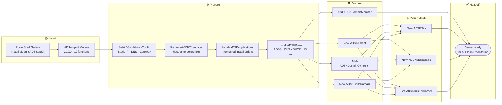
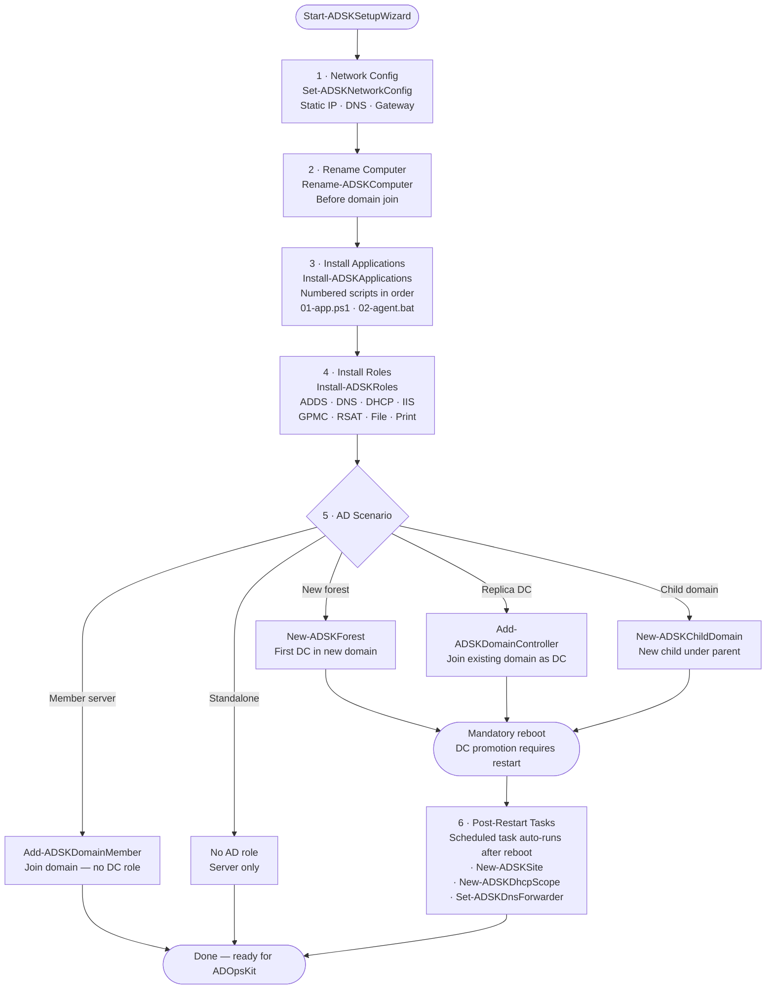

# ADSetupKit — Workflow

> ADSetupKit provisions a new Windows Server and prepares it for its Active Directory role.
> Run it **before** [ADOpsKit](https://github.com/Karanth1992/ADOpsKit) — ADSetupKit stands the server up, ADOpsKit then monitors it.

## 1 · End-to-End Overview

---

## 2 · Wizard Flow (Start-ADSKSetupWizard)

---

## 3 · Functions at a Glance

| Function | Stage | Purpose |
|----------|-------|---------|
| `Set-ADSKNetworkConfig` | Prepare | Static IP, DNS servers, default gateway |
| `Rename-ADSKComputer` | Prepare | Set hostname before domain join |
| `Install-ADSKApplications` | Prepare | Run numbered install scripts in order |
| `Install-ADSKRoles` | Prepare | Install Windows roles/features (ADDS, DNS, DHCP, IIS, GPMC, RSAT, File, Print) |
| `New-ADSKForest` | Promote | Create first DC in a new forest/domain |
| `Add-ADSKDomainController` | Promote | Join an existing domain as a replica DC |
| `New-ADSKChildDomain` | Promote | Create a new child domain under a parent |
| `Add-ADSKDomainMember` | Promote | Join domain as a member server (no DC role) |
| `New-ADSKSite` | Post-restart | Create AD site/subnet definitions |
| `New-ADSKDhcpScope` | Post-restart | Create and authorize a DHCP scope |
| `Set-ADSKDnsForwarder` | Post-restart | Configure DNS conditional/global forwarders |
| `Start-ADSKSetupWizard` | Orchestrator | Interactive wizard tying all stages together |

---

## 4 · Version History

| Version | Date | What changed |
|---------|------|-------------|
| **1.0.0** | 2026-06-28 | Initial PSGallery release — 12 provisioning functions and interactive setup wizard |
